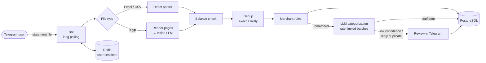

# Personal AI Accountant

A Telegram bot that turns Turkish bank statements into a categorized expense tracker. Send it a PDF, Excel or CSV statement; it extracts every transaction, categorizes them with an LLM, asks you only about the ones it isn't sure of, and gives you monthly, yearly and custom-range reports.

> **Status:** a local / portfolio project. It is intentionally not deployed as a public service. See [Privacy and KVKK](#privacy-and-kvkk) for why.

## Features

- **Statement upload** – PDF (up to 20 pages, read page-by-page by a vision LLM), Excel and CSV (parsed directly, no AI needed). Files up to 10 MB.
- **AI categorization** – learned merchant rules first, then the LLM in batches of 75; low-confidence results go to a review step instead of being guessed.
- **Review in Telegram** – confirm the suggestion, skip, or pick a category: your most-used categories first, a paged list of all, and search-as-you-type with an explicit *Create* button.
- **Learns from you** – every confirmation becomes a merchant rule, so the same merchant is categorized automatically next time.
- **Duplicate-safe uploads** – re-uploading a statement, or the same statement in another format, never double-counts a transaction (see [How duplicates are handled](#how-duplicates-are-handled)).
- **Balance check** – flags rows whose running balance doesn't add up, a sign of a misread amount.
- **Reports and browsing** – expenses by category with percentages, income, net; per month, this year, all time or a custom date range. Browse, re-categorize or delete individual transactions.
- **Category management** – rename (renaming to an existing name merges the two), delete with reassignment.

## How it works



- **Sessions** (where a user is in a review, which transaction is current) live in **Redis** with a 24 h TTL, so restarts and redeploys don't lose in-progress reviews.
- **LLM calls** go through a shared client-side **rate limiter** sized to the provider's limit. PDF pages are retried when the model returns malformed or truncated JSON; a categorization batch that fails goes to manual review instead of being guessed.
- Uploads are processed on a **bounded thread pool**; the bot stays responsive while a large statement is being categorized.

## Engineering highlights

| Area | What was done |
|---|---|
| **Idempotent ingestion** | Every transaction gets a dedup key: date, amount, balance after the transaction, normalized description, plus `#n` for repeated identical rows. A **unique constraint** on `(telegram_user_id, dedup_key)` makes a double save impossible even under concurrency; a duplicate insert is treated as "already saved". |
| **Cross-format duplicates** | Normalization folds Turkish letters (`Ş→s`, `İ/ı→i`), case, punctuation, masked card numbers and long reference numbers, so the Excel and PDF versions of a transaction match. Near-matches (same date and amount, similar description) are **never dropped silently** — they go to review with a *don't save* button. |
| **Safe review flow** | Stale or double-tapped Telegram buttons and redelivered updates are ignored, so they can't save twice or act on the wrong transaction. |
| **Schema migrations** | Flyway owns the schema (`db/migration`); Hibernate only validates it (`ddl-auto=validate`), so a missing migration fails loudly at startup instead of silently changing the database. |
| **Provider-agnostic AI** | Base URL, models, timeout, reasoning effort and rate limit are environment variables — any OpenAI-compatible provider works without code changes. |
| **Tests and CI** | Unit tests for the dedup logic; an integration test that starts the whole application against **real PostgreSQL and Redis via Testcontainers**, applying the Flyway migrations. GitHub Actions runs everything on every push and builds the Docker image. |
| **Privacy-aware logging** | Compact INFO logs with categorization progress and summaries; per-transaction lines (real bank data) only at DEBUG, never by default. |

## Tech stack

| | |
|---|---|
| Language / framework | Java 26, Spring Boot 4.1, Spring AI 2.0 |
| Data | PostgreSQL 17 (JPA/Hibernate, Flyway), Redis 7 |
| Bot | TelegramBots (long polling) |
| Documents | Apache PDFBox (PDF → images), Apache POI (Excel), OpenCSV |
| Resilience | Resilience4j rate limiter |
| Tests | JUnit 5, AssertJ, Mockito, Testcontainers |
| Delivery | Docker (multi-stage, non-root), Docker Compose, GitHub Actions |

## Getting started

### Prerequisites

- **Docker Desktop** (or Docker Engine + Compose)
- A **Telegram bot token** from [@BotFather](https://t.me/BotFather)
- An API key for an **OpenAI-compatible LLM provider** (defaults to [OpenRouter](https://openrouter.ai))
- Java 26 only if you want to run the tests or develop outside Docker

### Run it

```bash
git clone https://github.com/LilWndrr/personal-ai-accountant.git
cd personal-ai-accountant
cp .env.example .env
```

Fill in `.env` — at minimum `POSTGRES_PASSWORD`, `TELEGRAM_BOT_TOKEN` and `AI_API_KEY` — then:

```bash
docker compose up -d --build
docker compose logs -f app
```

Wait for `Telegram bot registered and long polling started.` and send `/start` to your bot. Flyway creates the schema on first start and the default categories are seeded automatically.

```bash
docker compose down        # stop (data is kept)
docker compose down -v     # stop and DELETE all data
```

Run only one instance per bot token — two pollers on the same token fail with `409 Conflict`.

### Run the tests

```bash
./mvnw clean verify
```

Docker must be running: the integration test starts its own throwaway PostgreSQL and Redis containers.

## Configuration

All settings come from environment variables (`.env` with Docker Compose). See [`.env.example`](.env.example) for the full, commented list.

| Variable | Default | Purpose |
|---|---|---|
| `TELEGRAM_BOT_TOKEN` | – | Bot token from BotFather |
| `POSTGRES_DB` / `POSTGRES_USER` / `POSTGRES_PASSWORD` | – | Database created by Compose |
| `AI_API_KEY` | – | LLM provider key |
| `AI_BASE_URL` | `https://openrouter.ai/api/v1` | Any OpenAI-compatible endpoint |
| `AI_CHAT_MODEL` | `minimax/minimax-m3.1-flash:free` | Vision model that reads PDF pages (must accept images) |
| `AI_CATEGORIZATION_MODEL` | same as `AI_CHAT_MODEL` | Model that categorizes transactions |
| `AI_REASONING_EFFORT` | `low` | Set it empty for models that reject the parameter |
| `AI_RATE_LIMIT_PER_MINUTE` | `18` | Client-side cap; keep it just under your provider's limit |
| `APP_LOG_LEVEL` | `INFO` | `DEBUG` logs every transaction's category — contains bank data, local use only |
| `SPRING_PROFILES_ACTIVE` | – | `prod` locks logging and SQL output down |

## How duplicates are handled

1. **Keys over the whole statement.** Each row's key is computed before any filtering, so the same statement always produces the same keys.
2. **Exact match → skipped.** A key the user already has is dropped automatically ("Skipped N duplicates").
3. **Likely match → asked.** Same date and amount, compatible balance and a similar description (e.g. the Excel export vs. the LLM-read PDF) goes to review with a *don't save* option. Two real identical purchases look exactly like this, so the bot never decides on its own.
4. **Database as the backstop.** The unique constraint catches anything that slips through — concurrent uploads, double taps, redelivered updates.

## Project structure

```
src/main/java/com/example/springaitest/
├── api/config/            core: entities, repositories, DTOs, services
│   ├── domain/            Transaction, Category, MerchantMapping
│   ├── Repository/        Spring Data repositories
│   └── service/           parsing, categorization, deduplication
└── bot/                   Telegram layer
    ├── commands/          /start, /report, /transactions, /categories, /about
    ├── state/             one handler per conversation state (state machine)
    ├── service/           upload workflow, review, reports, category picker
    └── events/            outgoing messages
src/main/resources/db/migration/   Flyway migrations
deploy/backup-db.sh                daily PostgreSQL backup to S3
.github/workflows/ci.yml           CI pipeline
```

## Privacy and KVKK

This bot processes bank statements — financial personal data, including third parties' names and IBANs in transfer descriptions. Running it as a public service in Turkey falls under **KVKK (Law No. 6698)**, and two parts of the design make that costly for a personal project:

- **Hosting abroad** (e.g. AWS Frankfurt, as there is no AWS region in Turkey) is a transfer of personal data abroad under **KVKK Article 9**. Since the 2024 amendment, ongoing transfers need a safeguard such as the Board's **standard contract**, notified to the Authority within five business days; explicit consent is no longer a basis for regular transfers.
- **Foreign LLM providers** receive statement content too — PDF pages are sent as images, including the header with the account holder's details — so they are transfers abroad as well, through a chain of providers.

For these reasons the project runs **locally only** (personal use is outside KVKK's scope). A compliant public version would keep data in Turkey, mask personal data (IBANs, ID numbers, names, statement headers) before any AI call, prefer Excel/CSV over PDF, and add a privacy notice and a delete-my-data command.

*This is a summary of my own research, not legal advice.*
